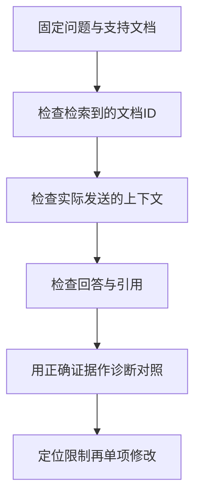

# 检索与工具调用

当前为待实践专题。先回答两个具体问题：外部证据怎样改变模型回答？让模型调用工具后，怎样确认任务真正完成？前置为token与生成、JSON/HTTP基础、固定数据集和[评测协议](/evaluation/)。

## RAG需要拆开的机制

经典RAG将检索结果作为生成条件，论文形式中还对检索文档进行边缘化；常见工程实现则把若干检索片段拼进上下文。两者有关联，但不应把“向量库加prompt”写成已复现原论文训练方法。[RAG v4](https://arxiv.org/abs/2005.11401v4)

| 环节 | 要解释的机制 | 最小对照 |
| --- | --- | --- |
| 文档处理 | 切块、重叠、元数据、版本与文档ID | 固定文档，比较两种切块大小 |
| 检索 | 稀疏词项匹配与dense embedding的不同归纳偏好 | 小语料先用TF-IDF，再选一个固定embedding模型 |
| 排序 | 召回候选与reranker精排承担不同任务 | 相同候选集，比较有/无rerank |
| 上下文构建 | top-k、去重、证据顺序、预算与截断 | 固定总token预算，移动证据位置或加入干扰段 |
| 生成 | 按证据回答、引用、冲突处理与无证据情形 | 无检索、实际检索、人工给定正确证据三组 |

“模型支持很长上下文”不等于能稳定利用所有位置的信息。可依据[Lost in the Middle v3](https://arxiv.org/abs/2307.03172v3)设计位置扰动测试；论文讨论的是其测试条件，不能直接推断所有新模型都有相同退化幅度。

## 把检索和生成的错误分开

准备带`question_id`、可接受答案和`support_doc_ids`的样本。若某题有多个相关文档，检索Recall@k可定义为前k项中相关文档数除以该题相关文档总数，再按题聚合；同时注明相关文档标注是否完整。对排序可补MRR或nDCG，但不要把它们当作最终答案正确率。

逐题分为：无证据可检索、检索遗漏、检索命中但证据被截断、模型误读/补造、答案正确但引用不支持。人工正确证据组用于估计生成环节的限制；它不是可部署系统的成绩。

### 一个问题，沿证据真正到达的位置诊断

构造合成文档D1：“设备A的检查周期为7天”；D2包含相似词语，但只描述“设备A的电池为7伏”。问题是“设备A多久检查一次”，正确支持文档为D1。这里的文档和下面的结果模式均为教学构造，不是已经观测到的模型行为。

如果top-1返回D2，Recall@1为0，先查检索与排序；若top-2同时包含D1、D2，单个相关文档的Recall@2为1，但回答“7伏”仍然错误。检索指标已满分不意味着任务闭环正确。

<figure class="research-figure">

<figcaption>从检索ID一直检查到实际上下文和回答，正确证据组用于定位限制，不能替代真实检索系统成绩。</figcaption>
</figure>

关键不是只看检索日志：D1可能被截断、去重规则错误删除，或在模板组装时没有真正送到模型。应保存“实际发送的上下文”，逐层检查证据链。

| 结果模式 | 优先检查 | 还不能下什么结论 |
| --- | --- | --- |
| 真实检索错误，人工正确证据组答对 | 检索、排序或上下文构建 | 不能只凭总分差就把问题全部归于embedding |
| 检索ID命中，实际上下文没有D1 | token预算、截断、模板和数据拼接 | 增大top-k不一定修复它，反而可能更早挤掉证据 |
| 只提供D1仍答错 | 问题歧义、模板、任务能力与答案提取 | 不能期待单独更换检索器必然解决 |
| 无检索答对，加入D2后答错 | 干扰、冲突处理和上下文利用 | 不能推广为所有问题都不需要RAG |

人工正确证据组是诊断干预，会改变证据可得性；它不是与线上系统等成本的方案。正式比较两个检索器时，应保持问题、切块、top-k、总输入预算、生成设置和评分一致；位置或顺序实验则单独固定证据集合。一次只改变当前要检验的因素。

## 工具调用与agent的最小闭环

工具调用至少有五步：生成工具名与参数、解析校验、执行授权、返回结构化结果、决定继续或终止。JSON合法只证明语法通过，不证明选对工具、参数正确或副作用被授权。

固定工作流由代码决定步骤；agent允许模型决定部分后续动作。ReAct研究交替生成推理与动作；实际项目应保存可公开的动作与观察轨迹，不要求公开模型的私有思维过程。[ReAct v3](https://arxiv.org/abs/2210.03629v3)

本站计划的执行约束为：

- 从本地、只读、可重放的搜索或计算工具开始，工具schema、参数类型、范围与返回结构明确。
- 权限在执行器中校验。检索文档和工具返回值作为数据，不能自行改变系统权限；构造这类异常输入作为测试。
- 为总步数、时间、token、重试和输出大小设置上限，记录成功、失败、取消与预算耗尽的终止原因。
- 重试区分暂时错误与确定性错误；有副作用的动作需在真实授权范围内设计幂等与确认，这个学习实验不实际发送消息或操作生产系统。

这些是实验设计要求，不是ReAct论文已经证明的安全保证。可参考[Anthropic对工具设计和agent反馈循环的说明](https://www.anthropic.com/research/building-effective-agents)，再验证自己的执行器行为。

### JSON成功、调用成功和任务成功是三个事件

设一个只读合成任务：查询本地记录R1的状态，并返回状态与记录ID。模型产生合法JSON，只说明解析器通过；若参数误写R2，工具可以成功返回另一条记录，任务仍失败。反过来，第一次调用超时、第二次在预算内正确返回R1，并通过最终状态检查，可以记为任务成功，同时保留一次工具失败。

日志至少按`task_id`、`step_id`串起工具名与参数、校验/执行状态、观察结果及终止原因。对于本地mock，可人为设置空结果或一次暂时超时，预测状态机的下一步，再与真实事件比对。重复相同确定性参数错误却不断重试，不能被“最终生成了回答”掩盖。

因此，分别记录解析通过率、参数/工具正确率、单次执行成功率和最终任务成功率。比较固定工作流与工具循环时，同时约束最大步数、token和时间，并保留预算耗尽的任务；否则“反复尝试直到成功”只是多花了预算，不证明调度或规划更好。此处只验证无害只读任务，不涉及真实外部操作。

## 两轮低成本项目

**第一轮：检索诊断。** 自建或选取许可明确的20–50份短文档与30条问答，保留来源和版本。先在CPU上实现TF-IDF检索与Recall@k；接一个固定小模型后比较无检索、实际检索、正确证据三组。改变一个切块或top-k配置，保存每题检索ID、输入上下文和输出，不能只截几张成功对话。

**第二轮：工具轨迹。** 为同一组可验证任务建立“直接回答、固定工作流、最多三步工具循环”三组。先用固定输出的假模型验证状态机，再用真实小模型/API执行同一协议。故意加入不存在的工具、非法参数、空结果、超时与恶意文档指令，检查终止行为；假模型结果只属于工程测试。

有明确假设后再考虑租GPU进行embedding或生成吞吐实验；先冻结数据与token预算，不因资源变多扩大题目和工具数量。

## 验收与常见误区

产物包括语料清单与划分、检索明细、答案及引用评分、工具事件日志、三组对照和失败归因。主要指标为任务成功率、检索Recall@k、引用支持率、工具选择/参数正确率、步数、超时率、端到端延迟与消耗token；任务成功由最终可检查状态决定。

常见误区：只测检索不测答案；把无证据时的流畅回答算成功；将测试答案混入索引而未声明；只检查JSON格式；无限重试“直到成功”；用多agent数量替代任务证据；借助工具得到答案后却归因为模型本身知识增长。

核验日期：2026-11-16。RAG使用v4，ReAct与Lost in the Middle使用v3；当前尚无本站个人复现或系统效果结论。
