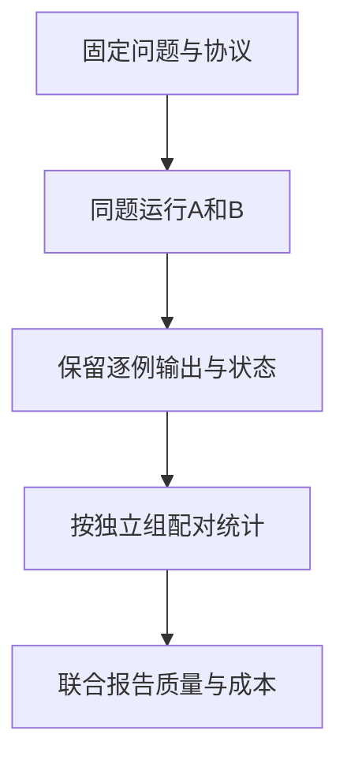

# 质量与服务成本实验

当前为学习与实验任务，尚无个人基准结果。核心问题是：一次模型、训练或服务配置改动，是否在目标任务上带来可靠收益，代价又是什么？

## 前置知识与范围

先掌握[模型基础](/foundations/)中的token、概率与生成，能够读写逐样本JSONL；做服务实验前，再理解[推理与系统](/inference/)的prefill、decode与缓存。先用几十个自建公开样本检查链路，后续才扩展正式评测集；小样本只能作为冒烟检查。

## 质量指标必须对应任务

| 任务 | 主要判据 | 必须额外检查 |
| --- | --- | --- |
| 分类、选择、抽取 | accuracy、exact match或任务定义的F1 | 答案提取、规范化、类别不均衡与格式失败 |
| 代码与数学 | 测试用例、可验证最终答案 | 环境与超时、测试覆盖、生成次数和采样预算 |
| 检索问答 | 检索命中、答案正确性、引用支持 | 检索遗漏与生成误读分开归因 |
| 开放回答 | 明确rubric、盲评与人工抽查 | 裁判偏差、长回答优势、答案顺序与一致性 |
| 训练后的通用退化 | 固定通用回归集 | 目标任务提升是否伴随其他能力损失 |

生成准确率与候选答案概率评分衡量的行为不同；改变输出长度或采样次数，也改变了推理预算，不能只看最终分数。用[HELM的多指标方法](https://arxiv.org/abs/2211.09110v2)理解取舍，再针对具体任务写自己的评分协议。

### 不确定性与污染

同题两方案的差值可写成 $\widehat{\Delta}=\frac{1}{N}\sum_i(s_i^B-s_i^A)$。学习时用成对bootstrap估计差值区间：以独立问题为重采样单位，让同题的A、B结果始终成对；若样本来自同一文档或同一会话，应按文档/会话成组，而不是把token当作独立样本。[SciPy bootstrap文档](https://docs.scipy.org/doc/scipy/reference/generated/scipy.stats.bootstrap.html)说明了paired索引重采样的语义；区间不是排除偏差和污染的保证。

精确哈希匹配只能检测相同原文或相同规范化结果；MinHash、SimHash等近似方法与它不同。还需要检查近重复、来源重叠、答案泄漏与训练集混入。对无法查明训练数据的模型，明确“训练污染未知”，不要宣布已经证明无污染。

### 算例：多答对一题，能支持多大的结论

以下数字是为了复算统计而构造的教学例子，不是模型实测。对同一组8题，记录A、B是否正确：

| 成对结果 | 题数 | 对B减A正确题数的贡献 |
| --- | ---: | ---: |
| A、B都正确 | 3 | 0 |
| A正确、B错误 | 1 | −1 |
| A错误、B正确 | 2 | +2 |
| A、B都错误 | 2 | 0 |

A为4/8，B为5/8，差值为12.5个百分点。只保留两个总分，会丢失“B修复了两题，也损失了一题”的信息；一份与该表对应的逐题差值是`[0,0,0,-1,1,1,0,0]`。

若按这8个成对差值做有放回重采样，每次仍抽8题，正、负、零三类的概率分别为2/8、1/8、5/8。可枚举三类的多项计数，按各计数事件的概率加权，得到每次平均差值的bootstrap分布。取该离散分布的2.5%与97.5%分位点，percentile区间为−25至+50个百分点，跨过0。这个小例子不足以支持“B已稳定更强”；它也只反映问题重采样，不包含训练随机性、裁判误差和训练污染。percentile与BCa是不同区间算法，不能把该数值写成任何库默认方法的必然输出。

再考虑20份文档，每份生成10个改写问题。若同文档10题的对错完全同步，200行记录仍只提供20组独立信息。用二元得分、正确率0.5作简化计算，把200行误当独立样本得到的标准误约0.035，而按20组计算约0.112，差约 $\sqrt{10}$ 倍。真实组内相关未必完全相同，但“增加改写行数就等价增加独立证据”的推断已经失效；应按文档组重采样，并保留组内题目。

### 实验记录怎样变成结论

<figure class="research-figure">

<figcaption>先保留同题记录，再按独立组比较，聚合结论才能追溯到具体输入与输出。</figcaption>
</figure>

这条链的关键是先建立可配对、可追溯的记录，再聚合。发现某题评分不合理时，应能回到原始输入和输出重算；如果只留下汇总图，无法区分模型变化、评分器变化与样本变化。

### 模型裁判也需要验收

[MT-Bench与LLM-as-a-judge论文v4](https://arxiv.org/abs/2306.05685v4)讨论了位置、冗长和自我偏好等偏差。计划的最低检查为：固定裁判模型、提示与rubric；交换A/B顺序；隐藏模型名；人工复核一组分歧样本，并报告裁判与人工的分歧。不要把裁判解释当作正确性的独立证明；可执行测试优先直接执行。

## 服务指标与负载

用客户端单调时钟记录发送、首个有效输出token、后续token和完成时间。流式chunk不一定等于一个token，需明确测量的是chunk间隔还是token间隔。

| 指标 | 本实验采用的口径 |
| --- | --- |
| TTFT | 请求发出到首个有效输出token；注明是否含客户端排队、网络与服务排队 |
| TPOT | 对输出token数 $N_{\text{out}}>1$ 的请求，采用 $(t_{\text{last}}-t_{\text{first}})/(N_{\text{out}}-1)$；单token请求单列 |
| ITL | 相邻输出token间隔分布；不能用平均TPOT代替尾部停顿 |
| 端到端延迟 | 从约定起点到请求完成；明确传输与排队边界 |
| 吞吐 | 单位时间完成的请求或输出token；分别报告口径 |
| Goodput | 单位时间满足预先约定SLO的成功请求；同时保留总请求分母 |
| 内存与费用 | 峰值已分配/保留显存分别记录；费用注明设备计费时间、空闲与加载是否包含 |

[DistServe v3](https://arxiv.org/abs/2401.09670v3)以TTFT、TPOT约束讨论goodput；[vLLM bench serve文档](https://docs.vllm.ai/en/latest/cli/bench/serve/)提供相关百分位和SLO选项。不同工具可能有不同时间边界，实验前核对实际版本实现。

输入/输出长度分布、到达率、并发上限、预热、缓存命中和持续时间都要固定。闭环并发会在服务变慢时降低发压速率；开环到达率可能产生持续排队。两种方式分别有用，但结果不能直接混比。报告p50/p95及样本量；极少请求的p99不应被当作稳定容量指标。

### 算例：吞吐、goodput与失败分母

为验证聚合口径，构造一个不含预热、完整观测60秒的记录：120个请求均已终止，其中100个成功、20个失败；成功请求里70个同时满足TTFT≤500ms、TPOT≤50ms。设这些请求均输出至少2个token，到达窗口与排空时间另行记录。

| 指标 | 计算 | 结果 |
| --- | --- | ---: |
| 成功请求吞吐 | 100 / 60秒 | 约1.67请求/秒 |
| Goodput | 70 / 60秒 | 约1.17请求/秒 |
| 全部请求中的SLO达标比例 | 70 / 120 | 约58.3% |
| 仅成功请求中的条件达标比例 | 70 / 100 | 70% |

最后一项不能替代倒数第二项，否则20个失败请求会从结论中消失。若观测截止时仍有未终止请求，应明确排空、超时或删失处理，不能悄悄把它们当作不存在。把这个例子送入统计器，四个数应能从同一批事件复算出来；这是测量程序的检查，不是某个推理框架的性能结果。

即使新配置goodput更高，也先核对输出预算、任务正确性和计时边界。更短的错误回答、不同缓存命中率或不同发压模式，都可能改变数字，不能自动归因为调度算法更好。

## 低成本实验顺序

1. **CPU评分链路**：准备30–50条可公开、可人工判定的小任务和故意出错的候选输出，验证答案提取、无效格式、超时与重复样本处理。此步只证明评分器行为。
2. **CPU统计检查**：给定成对分数，计算差值与区间；构造一份同文档重复数据，比较逐题与分组重采样，解释独立性假设。
3. **真实小模型质量基线**：冻结一个小模型、模板、数据散列和生成预算，保存逐样本输出。调参只用开发集，最终验收另留测试集。
4. **可选租GPU服务实验**：只改变一个因素，例如并发或一种精度；先短时间预热与冒烟，再在约定费用内跑长度分组和负载阶梯。预先写明停止条件，不默认长时间满负荷运行。

## 验收产物与常见错判

交付一份实验协议、逐样本质量结果、请求时间线、配置与版本清单、可重算统计脚本，以及至少三类失败案例。报告必须同时展示收益与退化，并标明模拟、CPU模型或真实GPU证据。此处没有预填任何性能提升目标。

常见错判包括：只挑好例子；删掉失败请求后算吞吐；把更多输出token当作更强能力；对测试集反复调参；只报告平均延迟；比较不同长度/缓存/采样预算；用模拟后端证明GPU提速。

核验日期：2026-11-16。论文固定为上述版本；SciPy核验页面显示v1.18.0，vLLM引用在线文档，执行时须记录实际安装版本、help与相关源码commit。
