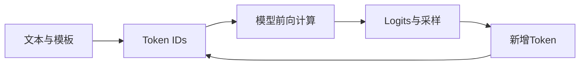

# 模型基础

这里组织推理与训练都需要的共同基础。每个主题先说明计算过程，再用小规模实现或对照检验理解。

## 一次生成经过什么

自回归模型逐步给出下一个token的条件分布 $p(x_{t+1}\mid x_{\leq t})$。先理解输入怎样变成这个分布，再分别研究训练与加速方法。

## 学习顺序

| 顺序 | 需要回答的问题 | 验证方式 |
| --- | --- | --- |
| 文本与token | 分词、特殊token与聊天模板怎样形成输入？ | 同一文本的编码、解码与模板对照 |
| 自回归生成 | logits、采样与停止条件怎样决定下一个token？ | 小词表概率计算与真实小模型生成 |
| Transformer | embedding、Attention、位置与因果mask怎样连接？ | 小张量逐步计算与模型结构追踪 |
| 训练目标 | next-token loss、梯度和优化器怎样改变权重？ | 一次正确参数更新与损失检查 |
| 规模与资源 | 参数、激活、KV缓存、计算与带宽怎样约束运行？ | 配置估算与实际测量分列 |

## 与后续专题连接

- 理解生成与概率后，进入[投机解码](/inference/speculative-decoding)。
- 理解训练目标后，进入[监督微调与后训练](/training/)。
- 每次实验都采用[评测与复现规范](/evaluation/)。

## 学习入口

[Hugging Face LLM课程](https://huggingface.co/learn/llm-course/chapter1/1)、[PyTorch基础](https://docs.pytorch.org/tutorials/beginner/basics/intro.html)。这些是材料入口；具体文章和实验按完成情况逐步加入。
