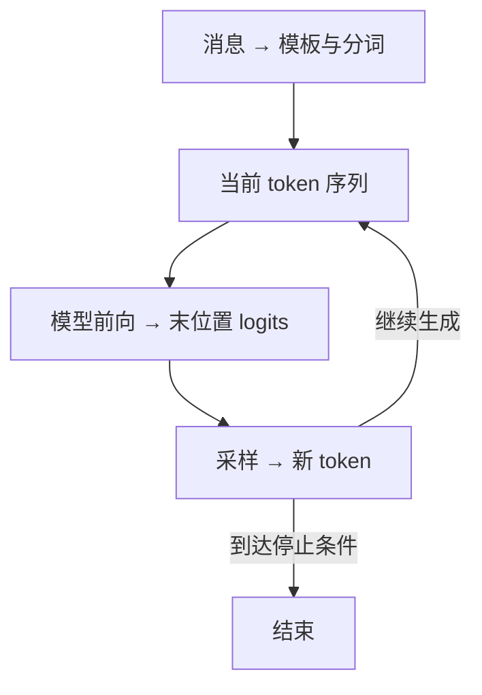

# 模型基础

这里组织推理与训练都需要的共同基础。学习从文本、张量与概率进入模型，随后连接数据、训练、缓存和服务。地图用于安排学习，页面存在不代表相应实验已经完成。

## 两条基础线

- **[编程、数学与训练机制](/foundations/programming-math)** 程序、张量、概率和梯度怎样连接？ 解释一个真实生成程序和一次参数更新，修复形状或标签错误。
- **[Transformer与架构演进](/foundations/transformer-architectures)** token 怎样变成 logits，架构怎样影响计算与缓存？ 完成因果 Attention 对照、张量形状图和两种架构的资源假设比较。

学习顺序与其他领域的联系见[完整知识地图](/roadmap/)。数学随当前问题补齐；不要求先学完整门课程才开始模型实验。

## 一次生成经过什么

给定已有的 token 序列 $x_{\leq t}$，模型在末位置给出一组 logits，采样器据此选择 $x_{t+1}$。聊天模板通常在生成前一次性处理消息；后续每步直接追加 token ID。采样温度、截断策略或随机种子即使不改模型权重，也可能改变输出。

<figure class="research-figure">

<figcaption>生成循环只追加 token ID。带 KV 缓存时，“当前 token 序列”由已缓存的前缀状态和本步输入共同表示。</figcaption>
</figure>

用同一组 logits 做一次解析对照。两个 token 的 logits 为 $(\log 3,0)$ 时，温度 $T=1$ 给出 $(3/4,1/4)$；用 $z/T$ 计算且 $T=1/2$ 时，赔率从 $3:1$ 变成 $9:1$，概率是 $(9/10,1/10)$。在没有其他变换时，最大 logit 的位置保持，抽到第二个 token 的概率下降。模型前向和采样器可以据此分开检查。

## 学习顺序

| 顺序 | 需要回答的问题 | 验证方式 |
| --- | --- | --- |
| 文本与token | 分词、特殊token与聊天模板怎样形成输入？ | 同一文本的编码、解码与模板对照 |
| 自回归生成 | logits、采样与停止条件怎样决定下一个token？ | 小词表概率计算与真实小模型生成 |
| Transformer | embedding、Attention、位置与因果mask怎样连接？ | 小张量逐步计算与模型结构追踪 |
| 训练目标 | next-token loss、梯度和优化器怎样改变权重？ | 一次正确参数更新与损失检查 |
| 规模与资源 | 参数、激活、KV缓存、计算与带宽怎样约束运行？ | 配置估算与实际测量分列 |

## 进入下一阶段的标准

能沿文本→token→embedding→Attention/FFN→logits→采样解释一次生成；能说明训练时哪些参数、目标和梯度参与更新；能用反例检验因果mask，而不只展示一张矩阵图。随后进入[数据与预训练](/training/data-pretraining)、[SFT](/training/sft)和[缓存](/inference/kv-cache)。

常见错位包括：把token当单词，把logits当概率，把一次API调用当作理解模型，把训练loss下降当成任务能力提升，把教学小矩阵当成完整模型复现。

## 与后续专题连接

- 理解生成与概率后，进入[投机解码](/inference/speculative-decoding)。
- 理解训练目标后，进入[监督微调与后训练](/training/)。
- 每次实验都采用[评测与复现规范](/evaluation/)。

## 学习入口

[Hugging Face LLM课程](https://huggingface.co/learn/llm-course/chapter1/1)、[PyTorch基础](https://docs.pytorch.org/tutorials/beginner/basics/intro.html)。这些是材料入口；具体文章和实验按完成情况逐步加入。
