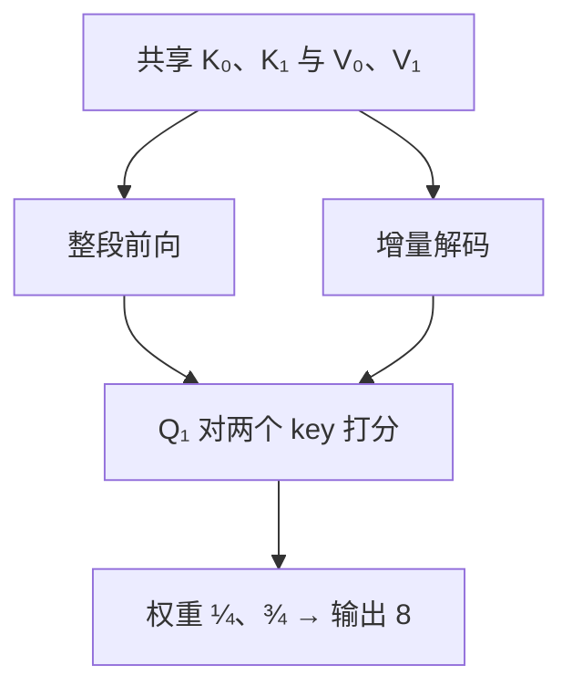

# Transformer与架构演进

## 问题与依赖

需要解释一次前向计算中，token如何变为下一个token的分布，并能推断架构变化影响了参数、计算、缓存还是通信。前置为[张量、概率与梯度](/foundations/programming-math)。本页定义待研究问题和实验，不声称已经实现或复现所列模型。

## 计算主线

常见因果语言模型经过token embedding、多层Attention/FFN与残差连接、归一化和输出映射产生logits。位置机制、归一化位置、激活函数、共享权重及注意力形式均须按具体配置核对。原始[Transformer论文](https://arxiv.org/abs/1706.03762v7)讨论encoder-decoder结构，不能直接将其结构图当作所有现代语言模型的实现。

对单个注意力头，

$$\operatorname{Attention}(Q,K,V)=\operatorname{softmax}\left(\frac{QK^\top}{\sqrt{d_k}}+M\right)V.$$

先设 $Q,K\in\mathbb{R}^{T\times d_k}$、$V\in\mathbb{R}^{T\times d_v}$；因果mask $M$ 在允许位置为0，在未来位置为负无穷。再补batch与head轴，分别说明训练的整段前向和带历史缓存的增量解码。不要把训练时并行处理位置理解成生成时可以无条件并行决定所有token。

### 同一组数据检验因果性和缓存等价

选一个头、两个位置，每个 $q,k,v$ 都是标量。设 $q_0=q_1=1$、$k_0=0$、$k_1=\log 3$、$v_0=2$、$v_1=10$。点积除以 $\sqrt{d_k}=1$ 后，两行原始分数均为 $(0,\log 3)$。对位置 $i$，许可条件是 key 的绝对位置 $j\leq i$，再叠加 padding 等约束。

| 计算方式 | 归一化后的权重 | 该位置输出 |
| --- | --- | --- |
| 整段前向，位置 0 | $(1,0)$ | $2$ |
| 整段前向，位置 1 | $(1/4,3/4)$ | $2/4+30/4=8$ |
| 增量解码，位置 1，含当前 token 的 K/V | $(1/4,3/4)$ | $8$ |
| 错把增量 query 当作位置 0，屏蔽 key 1 | $(1,0)$ | $2$ |

<figure class="research-figure">

<figcaption>整段前向取第 1 行，增量解码以位置 1 为当前 query。可见集合对齐后，两条路径执行同一行注意力；下标从 0 开始。</figcaption>
</figure>

把 $v_1$ 从 $10$ 改成 $18$，位置 1 应从 $8$ 变为 $14$，位置 0 依然为 $2$。若忘记因果 mask，位置 0 会同样从 $8$ 变成 $14$，可用这个反例和“缓存输出等于整段末位置”分别捕获未来信息泄漏及增量对齐错误。落到真实模型时，还要对齐每一层的位置、padding 和缓存布局；把各路径结果转换为同一 dtype 比较，并使用与精度匹配的误差阈值。

### 位置编码如何进入点积

RoPE 把向量的维度按对组成平面。在其中一个平面，令 $R(\theta)$ 为二维旋转，位置 $i$ 的 query 乘 $R(i\theta)$，位置 $j$ 的 key 乘 $R(j\theta)$。利用 $R(a)^\top=R(-a)$ 与旋转角可相加，

$$(R(i\theta)q)^\top (R(j\theta)k)=q^\top R((j-i)\theta)k.$$

取 $q=k=(1,0)^\top$、$\theta=\pi/2$，相差一个位置时得分是 $0$，相差两个位置时是 $-1$。同时移动两个位置的下标结果保持。这里的结论针对相同底层向量和固定频率表的点积；实际长上下文还受训练分布、位置缩放、可见窗口和每层隐状态影响。推理缓存要检查 K 保存的是旋转前还是旋转后布局。若缓存已保存旋转后的 K，本步给历史 K 再旋转一次会改变相对角度，用上面的两路径对照即可发现。频率与维度成对的实际写法按实现核对。参考 [RoFormer 原论文](https://arxiv.org/abs/2104.09864v5)。

## 架构知识树

| 方向 | 需要回答的问题 | 连接到什么实践 |
| --- | --- | --- |
| Embedding与输出层 | token ID怎样查表，词表与隐藏维度是什么，权重是否共享？ | 读取真实模型配置并核对参数形状 |
| 残差、Norm、FFN | 信息如何跨层流动，归一化放在哪里，门控FFN改变什么？ | 对照两个小模型的模块树与前向路径 |
| 位置与长上下文 | RoPE编码什么关系，窗口、插值、缩放与稀疏性改变什么？ | 长度分桶、位置移动、证据距离与质量回归 |
| MHA/MQA/GQA | query头与KV头如何对应，哪些状态共享？ | 推导[KV缓存](/inference/kv-cache)的形状与容量 |
| MLA与压缩缓存 | 具体架构压缩哪些投影，位置部分和恢复计算怎样处理？ | 按固定模型配置检查缓存张量；不套通用MHA公式 |
| Dense与MoE | 路由选哪些专家，shared/routed专家怎样组合，负载与通信代价是什么？ | CPU路由统计，再连接[专家并行](/training/distributed-training) |
| MTP等附加目标 | 增加了什么训练监督，草稿如何进入推理验证？ | [MTP](/inference/mtp)与[投机解码](/inference/speculative-decoding)分别验证 |

RoPE与GQA分别对照[RoFormer论文](https://arxiv.org/abs/2104.09864v5)、[GQA论文](https://arxiv.org/abs/2305.13245v3)。长上下文的“能够接收”与“能够可靠利用”分开评估，不能仅展示模型配置中的最大长度。

以 8 个 query 头、2 个 KV 头为例，每 4 个 query 头共享一组 K/V。对于常见连续分组，query 头 $h$ 读取 KV 头 $\lfloor h/4\rfloor$。设单层、单序列的长度 $T=4096$，头维 $128$，BF16 每元素 2 字节，纯 K/V 的体积为 $2\times 4096\times 2\times 128\times 2=4$ MiB；同形状的 8 KV 头 MHA 为 16 MiB。模型仍计算 8 组 query 的注意力分数。后端若把 K/V 物化扩展成 8 头进行计算，还要单独核对临时内存与带宽，资源算账要分别记录常驻缓存和算子临时工作区。更多边界见 [KV 缓存与 Attention 执行](/inference/kv-cache)。

## 版本案例：以问题比较模型

[DeepSeekMoE](https://arxiv.org/abs/2401.06066v1)和[V3技术报告](https://arxiv.org/abs/2412.19437v2)可作为理解专家路由、MLA及训练目标的教学锚点。总参数、每token激活参数、显存占用和真实吞吐是不同量；激活参数较少不意味着权重可全部不驻留，也不能忽略通信与共享模块。

前沿跟踪另看[DeepSeek-V4.1-Flash固定版本模型卡](https://huggingface.co/deepseek-ai/DeepSeek-V4.1-Flash/blob/314113f8a7dadb388215396ba5fbee2c610a04d6/README.md)：它描述CED架构及从编码器末态投影解码器全局KV的方式。这个例子提示需要逐版重新画数据流，不能把V3的MLA缓存公式、所有层的状态布局或旧框架支持列表直接移植到后续模型。模型卡中的大规模结果不作为个人实验成绩。

## 三个可执行实验

1. **因果Attention**：CPU上使用几个token计算显式Attention，再与固定版本的PyTorch SDPA对照；设置dropout为0并记录误差。改变未来token，检查较早位置输出是否保持一致。
2. **架构与容量**：从一个可运行的小模型读取层数、hidden size、头数、KV头数与dtype；画形状图并估算参数和KV容量，再与模型实际张量核对。估算不等于峰值显存实测。
3. **MoE路由**：使用小规模合成路由分数比较top-k与负载分布，构造专家倾斜案例。只验证路由行为；不将其称为完整MoE训练或分布式性能复现。

SDPA的布尔mask中True表示参与Attention，与MultiheadAttention的key_padding_mask语义不同；该函数是否使用dropout由传入参数决定。缓存解码时Q/K长度不同，还须核对mask的对齐方式。参见[PyTorch 2.15 SDPA文档](https://docs.pytorch.org/docs/2.15/generated/torch.nn.functional.scaled_dot_product_attention.html)。

增加一个反例：Q长度为1、历史KV长度为N时，直接使用该接口的is_causal=True会采用左上对齐，并不自动表示“当前token可见全部历史”。只有历史且无padding时，应允许全部历史位置；按真实位置显式构造mask或使用已验证的缓存实现，再与整段前向的末位置结果对照。

## 源码阅读与验收

固定入口：[DeepSeek-V3 inference/model.py](https://github.com/deepseek-ai/DeepSeek-V3/blob/9b4e9788e4a3a731f7567338ed15d3ec549ce03b/inference/model.py)。按配置→embedding→Attention→FFN/MoE→输出追踪一次调用，标出与教学模型不同的模块。该入口是阅读对象，不要求下载完整大模型权重。

交付形状图、显式与库实现的误差、因果性反例、真实配置容量表以及一个路由倾斜案例。能解释结果依赖哪些假设，并指出哪些结论需要GPU或多机才能验证。

资料核验日期：2026-11-16。接口参考版本不是要求安装的整套环境，运行时另锁定依赖。后续：[推理与系统](/inference/)、[数据与预训练](/training/data-pretraining)、[多模态](/applications/multimodal)。
