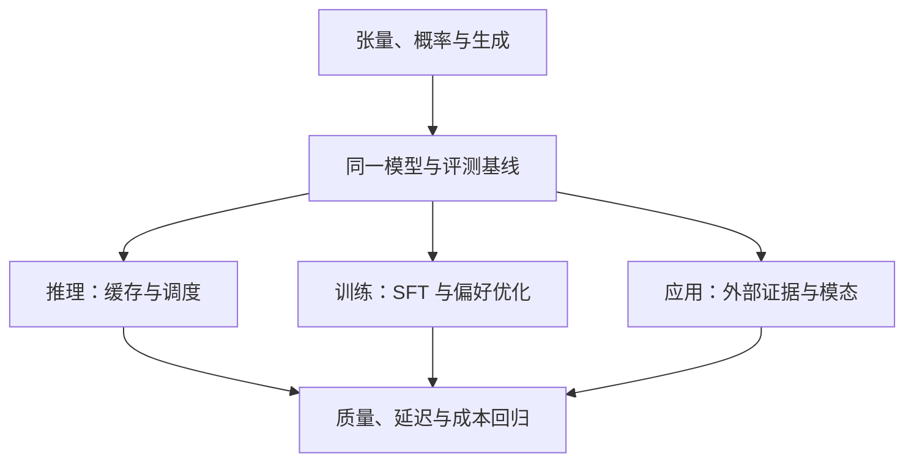

# 大模型知识与实践地图

同一个模型可以从三个问题进入。模型每步在计算什么，训练改变了哪些概率，服务如何用可接受的代价交付结果。地图把机制、实现与评测连起来，推理系统、监督微调和偏好优化各自有独立的实践与验收。

先沿一组可手算的问题进入专题。比较整段前向与增量解码的同一行输出，检查聊天标签在序列上如何错位，再在固定样本与负载下解释质量和延迟为何变化。专题内的解析对照用于检查理解，项目实验按实际进展记录。 [因果 Attention](/foundations/transformer-architectures) · [监督微调](/training/sft) · [联合评测](/evaluation/quality-systems)

## 全链路与主题入口

- <strong>编程、数学与数值</strong> 张量、概率、梯度、稳定计算与程序排错怎样连接？ [基础机制](/foundations/programming-math)
- <strong>模型架构</strong> token怎样变成logits，位置、GQA/MLA、MoE改变了什么？ [架构与Attention](/foundations/transformer-architectures)
- <strong>数据与预训练</strong> 数据来源、去重、配比、标签和污染怎样影响学习？ [数据与预训练/CPT](/training/data-pretraining)
- <strong>训练系统</strong> 参数、梯度、优化器和激活放在哪，通信何时发生？ [DDP/FSDP/ZeRO与并行](/training/distributed-training)
- <strong>监督微调</strong> 模板、loss mask、数据质量与低秩更新怎样影响适配？ [SFT、LoRA与QLoRA](/training/sft)
- <strong>偏好优化</strong> 偏好标签、参考策略与目标怎样改变行为？ [DPO与偏好数据](/training/preference-optimization)
- <strong>RL与推理能力</strong> 奖励、rollout、优势估计与更新怎样组成训练？ [PPO/GRPO、RLVR与蒸馏](/training/rl-training)
- <strong>内存与数值效率</strong> 哪些状态可缓存，低精度是否影响质量和性能？ [KV与Attention](/inference/kv-cache) · [量化](/inference/quantization)
- <strong>解码算法</strong> 草稿、目标验证和接受/校正怎样协作？ [投机解码](/inference/speculative-decoding) · [MTP](/inference/mtp) · [DSpark](/inference/dspark)
- <strong>服务与分布式推理</strong> 批处理、调度、并行和PD分离何时有收益？ [服务系统](/inference/serving-systems) · [DeepInfer](/inference/deepinfer)
- <strong>评测与实验方法</strong> 差异是否可信，质量、延迟、成本和失败如何同时判断？ [质量与系统评测](/evaluation/quality-systems)
- <strong>鲁棒性、安全与解释</strong> 扰动、拒答、外部指令与归因结论如何验证？ [受控评测与可解释性](/evaluation/robustness-safety)
- <strong>检索、Agent与多模态</strong> 模型、外部证据、工具和不同模态如何形成闭环？ [RAG与Agent](/applications/retrieval-agents) · [多模态](/applications/multimodal)

数据许可、版本、复现与安全边界贯穿各领域；不是最后才补的独立检查表。内核、编译器、稀疏架构、大规模训练与在线RL可继续专项深入，进入前先满足对应的数学、系统和实验条件。

## 学习依赖

先打通“文本→token→前向→logits→生成”，同时学习张量与训练目标。数据与评测基线随后为训练和服务的对照提供同一把尺子。

<figure class="research-figure">

<figcaption>三条实践从共同基线起步，各自做受控修改，最后回到同一批质量和成本问题。</figcaption>
</figure>

用同一批保留样本建立模型基线，训练项目再额外固定可见的训练数据。验证服务改造时锁定 checkpoint 与采样条件，验证训练改造时锁定服务配置，验证检索或模态改造时以现有输入链路为基准。先分别确定差异由哪个环节引入，再把新的 checkpoint、服务配置和应用流程合起来回归。

## 每个主题学到什么程度

下表是进展记录，不是四种可任选的毕业标准。要将一个方法记为深入掌握，需要把问题与依赖、推导或状态不变量、最小实现、固定源码、受控对照/反例、迁移与排错连成可审查的解释。具体标准见[博文与研究方法](/writing/)。

| 层次 | 需要的证据 | 不能替代它的东西 |
| --- | --- | --- |
| 能解释 | 自己的公式、形状图、假设和反例 | 收藏论文、记住术语 |
| 能验证 | CPU小实现或受控模拟、原始输入输出、检查与误差 | 仅运行他人脚本 |
| 能复现 | 锁定模型、数据、依赖、硬件与协议的真实实验 | 把论文结果或模拟速度当实测 |
| 能修改并定位问题 | 一个有理由的改动、合理基线、失败定位和回归 | 代码量、界面数量或AI调用量 |

不同领域的实际深度分别记录，不用一个部署项目代表已经掌握训练，也不用一次DPO运行代表完成在线RL。提出新算法、训练前沿基座或领导研究团队需要更多持续的研究与协作证据。

同页多个方法分别保留状态：KV复用、分页、FlashAttention与前缀共享不是一项验收；SFT、LoRA与QLoRA也不能共用一个“已掌握”。阶段只认识到的内容保留为待深入，逐步补齐依赖，不降低最终深度标准。

## 用主问题连接跨领域知识

| 主问题 | 连续的解释链 | 深入时必须能辨别 |
| --- | --- | --- |
| 生成怎样既正确又高效？ | 条件概率/因果Attention→KV等价与生命周期→布局与共享→调度、并行和负载→解码验证 | 输出语义、缓存状态正确性、接受性质和真实成本各自的证据 |
| 训练怎样改变能力？ | 数据与标签→loss/梯度→参数化与精度→分布式更新/恢复→偏好/奖励→独立质量回归 | 学到了任务、格式、长度偏好还是评测漏洞 |
| 应用怎样可靠地完成任务？ | 外部证据/模态输入→表示与上下文→模型输出→工具执行→轨迹与质量评测 | 检索/感知失败、模型判断、权限与系统执行错误 |

这些链条按问题选择切入点，不是要求先遍历所有分支。每个新设计都要解释它解决了上一步的什么限制，又引入了哪些条件和代价；不以术语出现的顺序代替技术因果。

## 阶段安排

| 阶段 | 主要实践 | 进入下一阶段前的验收 |
| --- | --- | --- |
| 基础与生成 | tokenizer、真实小模型生成、因果Attention、一次训练更新 | 能解释输入输出、目标、shape与故障 |
| 数据与推理基线 | 固定数据、质量评测、缓存/长度/负载对照 | 有逐例结果，能区分模型、系统和评测错误 |
| 监督微调 | 小规模LoRA SFT、adapter重载、数据或mask消融 | 有合理提示基线、保留集结果、退化和资源记录 |
| 偏好与后训练 | 偏好对、DPO目标验证、有界训练与偏差诊断 | 能解释参考策略、标签依据、长度偏差及能力回退 |
| 联合回归与进阶 | 新checkpoint部署、质量成本回归；按条件选RL/分布式/多模态专项 | 多个方向各有自己的实现、修改与复现证据 |

每轮围绕一个研究单位持续完成推导、实现、对照与排错，未闭合时跨周推进。排期表示时间窗口，不能在周末机械换题；时间不足就减少同期开题、缩小问题或延长周期。覆盖范围逐步扩展，未达到深度的内容继续标待深入，不能为了按时覆盖所有主题而降为名词介绍。

## 三个项目承接深度

- [推理算法与服务实验](/projects/serving-lab)：缓存、解码正确性与负载取舍。
- [数据与监督微调实验](/projects/finetuning-lab)：数据、mask、低秩更新与保留集对照。
- [偏好优化与后训练实验](/projects/post-training-lab)：偏好依据、优化、退化及部署回归。

共用模型、实验记录与评测，不重复建立多套管理平台。RAG与多模态先作有边界的小实验；根据实际问题再决定是否发展成独立项目。

## 记录、写作与版本

每次保存问题、资料/commit、数据与配置、基线、单一变更、原始结果、失败样例和结论边界；注明本人贡献与AI协作。博文从这些证据中整理，不额外制造一套没有实测的“成果”。参见[写作方式](/writing/)。

版本跟踪保留经典方法与固定教学模型，同时定期核对官方新报告的差异。V3/R1等报告是学习案例，不用作全部后续架构和框架支持的最新说明；新结果也不自动进入当前必做任务。
