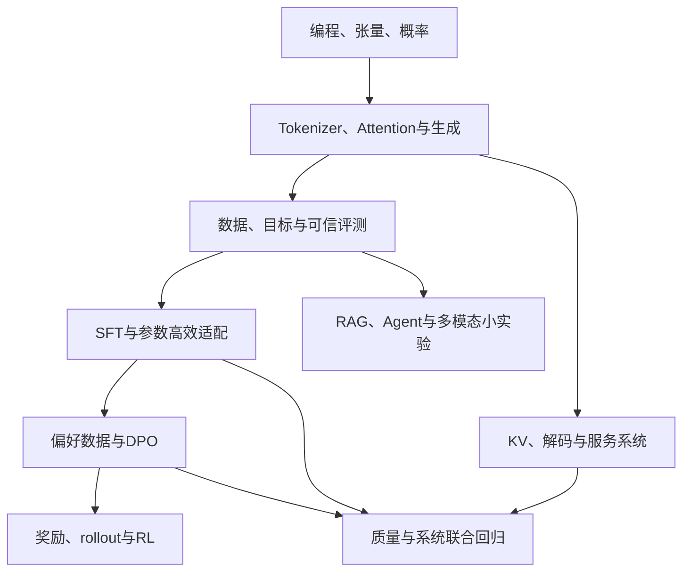

# 大模型知识与实践地图

目标是理解各环节如何联系，并在推理系统、监督微调和偏好优化分别积累实践。地图覆盖的范围大于任何一个阶段的任务清单。专题是待研究的学习规格；项目是待实践的任务书，已完成文章另见[文章索引](/articles/)。

## 全链路与主题入口

窄屏下可左右滑动宽表与依赖图，查看完整内容。

| 领域 | 必须能解释的核心问题 | 专题与实验入口 |
| --- | --- | --- |
| 编程、数学与数值 | 张量、概率、梯度、稳定计算与程序排错怎样连接？ | [基础机制](/foundations/programming-math) |
| 模型架构 | token怎样变成logits，位置、GQA/MLA、MoE改变了什么？ | [架构与Attention](/foundations/transformer-architectures) |
| 数据与预训练 | 数据来源、去重、配比、标签和污染怎样影响学习？ | [数据与预训练/CPT](/training/data-pretraining) |
| 训练系统 | 参数、梯度、优化器和激活放在哪，通信何时发生？ | [DDP/FSDP/ZeRO与并行](/training/distributed-training) |
| 监督微调 | 模板、loss mask、数据质量与低秩更新怎样影响适配？ | [SFT、LoRA与QLoRA](/training/sft) |
| 偏好优化 | 偏好标签、参考策略与目标怎样改变行为？ | [DPO与偏好数据](/training/preference-optimization) |
| RL与推理能力 | 奖励、rollout、优势估计与更新怎样组成训练？ | [PPO/GRPO、RLVR与蒸馏](/training/rl-training) |
| 内存与数值效率 | 哪些状态可缓存，低精度是否影响质量和性能？ | [KV与Attention](/inference/kv-cache) · [量化](/inference/quantization) |
| 解码算法 | 草稿、目标验证和接受/校正怎样协作？ | [投机解码](/inference/speculative-decoding) · [MTP](/inference/mtp) · [DSpark](/inference/dspark) |
| 服务与分布式推理 | 批处理、调度、并行和PD分离何时有收益？ | [服务系统](/inference/serving-systems) · [DeepInfer](/inference/deepinfer) |
| 评测与实验方法 | 差异是否可信，质量、延迟、成本和失败如何同时判断？ | [质量与系统评测](/evaluation/quality-systems) |
| 鲁棒性、安全与解释 | 扰动、拒答、外部指令与归因结论如何验证？ | [受控评测与可解释性](/evaluation/robustness-safety) |
| 检索、Agent与多模态 | 模型、外部证据、工具和不同模态如何形成闭环？ | [RAG与Agent](/applications/retrieval-agents) · [多模态](/applications/multimodal) |

数据许可、版本、复现与安全边界贯穿各领域；不是最后才补的独立检查表。内核、编译器、稀疏架构、大规模训练与在线RL可继续专项深入，进入前先满足对应的数学、系统和实验条件。

## 学习依赖

先打通“文本→token→前向→logits→生成”，同时学习张量与训练目标；再建立数据与评测基线。

这不是所有研究方法唯一的先修关系。DPO→RL是本学习路线的渐进安排，不代表DPO是所有RL算法的理论前提。分布式训练与内核优化在单机链路、资源估算和profile可解释之后逐步加入。

## 每个主题学到什么程度

| 层次 | 需要的证据 | 不能替代它的东西 |
| --- | --- | --- |
| 能解释 | 自己的公式、形状图、假设和反例 | 收藏论文、记住术语 |
| 能验证 | CPU小实现或受控模拟、原始输入输出、检查与误差 | 仅运行他人脚本 |
| 能复现 | 锁定模型、数据、依赖、硬件与协议的真实实验 | 把论文结果或模拟速度当实测 |
| 能修改并定位问题 | 一个有理由的改动、合理基线、失败定位和回归 | 代码量、界面数量或AI调用量 |

不同领域的实际深度分别记录，不用一个部署项目代表已经掌握训练，也不用一次DPO运行代表完成在线RL。提出新算法、训练前沿基座或领导研究团队需要更多持续的研究与协作证据。

## 阶段安排

| 阶段 | 主要实践 | 进入下一阶段前的验收 |
| --- | --- | --- |
| 基础与生成 | tokenizer、真实小模型生成、因果Attention、一次训练更新 | 能解释输入输出、目标、shape与故障 |
| 数据与推理基线 | 固定数据、质量评测、缓存/长度/负载对照 | 有逐例结果，能区分模型、系统和评测错误 |
| 监督微调 | 小规模LoRA SFT、adapter重载、数据或mask消融 | 有合理提示基线、保留集结果、退化和资源记录 |
| 偏好与后训练 | 偏好对、DPO目标验证、有界训练与偏差诊断 | 能解释参考策略、标签依据、长度偏差及能力回退 |
| 联合回归与进阶 | 新checkpoint部署、质量成本回归；按条件选RL/分布式/多模态专项 | 多个方向各有自己的实现、修改与复现证据 |

每轮只推进一个当前机制或改进因素。知识覆盖通过阅读与讲解扩展，实验深度通过阶段项目累积；不给所有主题同时安排GPU任务。

## 三个项目承接深度

- [推理算法与服务实验](/projects/serving-lab)：缓存、解码正确性与负载取舍。
- [数据与监督微调实验](/projects/finetuning-lab)：数据、mask、低秩更新与保留集对照。
- [偏好优化与后训练实验](/projects/post-training-lab)：偏好依据、优化、退化及部署回归。

共用模型、实验记录与评测，不重复建立多套管理平台。RAG与多模态先作有边界的小实验；根据实际问题再决定是否发展成独立项目。

## 记录、写作与版本

每次保存问题、资料/commit、数据与配置、基线、单一变更、原始结果、失败样例和结论边界；注明本人贡献与AI协作。博文从这些证据中整理，不额外制造一套没有实测的“成果”。参见[写作方式](/writing/)。

版本跟踪保留经典方法与固定教学模型，同时定期核对官方新报告的差异。V3/R1等报告是学习案例，不用作全部后续架构和框架支持的最新说明；新结果也不自动进入当前必做任务。
