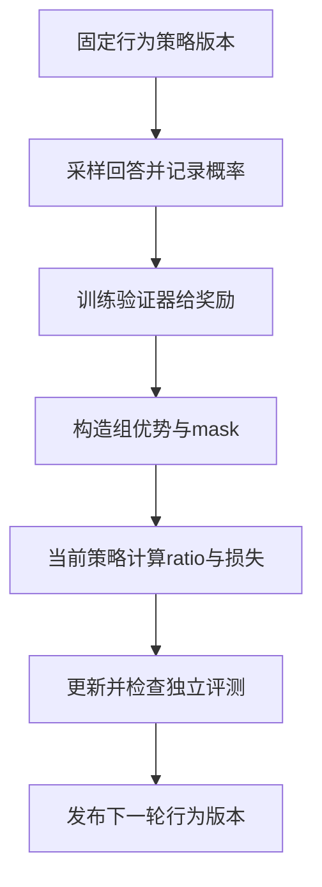

# 强化学习、蒸馏与可验证奖励

::: info 待研究专题
先做CPU概率、优势和奖励反例验证。真实模型RL是前置条件满足后的受控项目，当前未执行rollout训练或产生能力收益。
:::

## 问题与前置依赖

策略怎样从奖励中获得更新？rollout由哪个模型版本采样？奖励上升为何可能伴随任务质量下降？怎样避免把验证答案泄漏到策略输入？

本路线建议先学习[SFT](/training/sft)、[偏好优化](/training/preference-optimization)、条件概率与梯度，并建立独立评测和策略版本、mask、检查点记录。这是学习与实验的组织顺序，不是PPO/GRPO必须先做SFT或DPO的算法条件；R1-Zero没有先做SFT。本页可选实验选择已有SFT模型作为基线，先确认奖励能够被检查，再扩大训练。

## 方法与设置的关系

| 名称 | 所在层次 | 应核对的内容 |
| --- | --- | --- |
| PPO | 策略优化方法 | 概率比、clipped surrogate、优势估计；常见实现还学习value/critic |
| GRPO | 组相对策略优化方法 | 同一prompt多条采样的相对奖励、归一化和聚合；原方法不依赖单独critic估计组优势 |
| RLVR | 可验证奖励的训练设置 | 奖励来自任务验证规则，可搭配不同策略优化方法，不等于全部GRPO |
| rollout | 采样与环境交互过程 | 行为策略、解码配置、输出、反馈与logprob；只采样/打分不算策略更新 |

本页公式是便于验证的PPO/GRPO型目标示意，不能不加区分地套到所有变体。[PPO论文](https://arxiv.org/abs/1707.06347v2)、[DeepSeekMath](https://arxiv.org/html/2402.03300)和[TRL GRPO文档](https://huggingface.co/docs/trl/en/grpo_trainer)分别核对算法、原始组目标与当前实现。

## 核心概率与目标

`πθ`是当前可训练策略，`πold`是生成这一批数据的行为策略，`πref`是用于参考约束的策略。后两者角色不同。

$$
\rho_{i,t}=\exp\left(\log\pi_\theta(y_{i,t}\mid x,y_{i,<t})-\log\pi_{\rm old}(y_{i,t}\mid x,y_{i,<t})\right).
$$

一个clipped surrogate形式为：

$$
J=\mathbb E\left[\min\left(\rho A,\operatorname{clip}(\rho,1-\epsilon,1+\epsilon)A\right)\right]-\beta D_{\rm KL}(\pi_\theta\Vert\pi_{\rm ref}).
$$

这里省略具体token/序列聚合、value与熵项；实现时必须写清。clipping作用于代理目标，不是保证实际概率比永远被硬限制在区间内。

原始GRPO型组优势可示意为：

$$
A_i=\frac{r_i-\bar r}{s_r+\varepsilon}.
$$

CPU组实验使用同一prompt的至少两条采样，记录组的定义、标准差correction、epsilon和长度归一化，并检查样本数是否足以计算所选标准差。全相同奖励组的相对优势为零，但存在KL或其他项时，不能断言总梯度必然为零。不同prompt不可随意混成同一个奖励组。

当前TRL文档和快照包含DAPO等损失/归一化选择；不能把类名为GRPOTrainer就视为执行原始DeepSeekMath公式。核对实际`loss_type`、奖励缩放、β和importance修正，不依赖默认值猜测实验目标。

## 一条样本怎样走到策略梯度

先固定本节的范围：同步采样、同一prompt内多条回答、冻结一批行为数据，再优化一个明确记录的PPO/GRPO型目标。这不是所有RL实现的完整时序。

<figure class="research-figure">



<figcaption>先保存生成样本的行为概率，再更新当前策略；训练奖励参与更新，独立测试只用于评估，reference另用于已声明的约束项。</figcaption>
</figure>

在同一已采样token上，若行为策略概率为`0.20`、当前策略概率为`0.26`，则 $\rho=0.26/0.20=1.3$。即使reference概率为`0.40`，也不能用`0.26/0.40=0.65`替代它：前者衡量当前策略相对采样来源的变化，后者比较当前策略与参考，语义与后续更新方向均不同。实际计算使用对齐token的logprob差，避免先对长序列概率连乘下溢。

### clipping必须连着优势符号看

令 $\epsilon=0.2$，省略KL及其他项，只列需要最大化的单token surrogate：

| ratio ρ | 优势A | ρA | clip(ρ)A | 取min后的值 |
| --- | --- | --- | --- | --- |
| 1.3 | 1 | 1.3 | 1.2 | 1.2 |
| 1.3 | -1 | -1.3 | -1.2 | -1.3 |
| 0.7 | 1 | 0.7 | 0.8 | 0.7 |
| 0.7 | -1 | -0.7 | -0.8 | -0.8 |

对于正优势，过度增大该token概率的额外代理收益被截断；对于负优势，过度减小概率的额外代理收益被截断。相反方向的坏更新仍受惩罚。若实现最小化loss，应对这项取负，不能把`min`随意改成`max`而漏掉符号转换。clipping也没有把网络参数、实际KL或所有概率比硬限制在区间内。

CPU参考应分别在四个分支内检查导数，再在边界两侧作小扰动；恰在边界点的不可微约定不拿来验证唯一梯度。固定行为logprob不更新，reference分支冻结，但当前策略logprob必须保留梯度。将全部概率`detach`后仍能打印loss，却不会形成正确策略更新。

对应固定快照的[token级ratio](https://github.com/huggingface/trl/blob/f27a906d39cc60aeea576e616f9c829dc4a6ce44/trl/trainer/grpo_trainer.py#L3256)与[clipped surrogate分支](https://github.com/huggingface/trl/blob/f27a906d39cc60aeea576e616f9c829dc4a6ce44/trl/trainer/grpo_trainer.py#L3285)。本表选择对称clip、没有额外ratio上界的token级例子；若实际配置使用序列级importance权重、非对称clip或其他loss类型，就另写参考与预期。损失如何按token、回答及组聚合，也须在目标中明确。

### 组优势的数值与零信号边界

对同一prompt的四条回答，取奖励`[0,0,1,1]`。均值为`0.5`，若用总体标准差、暂忽略epsilon，则标准差为`0.5`，优势为`[-1,-1,1,1]`。若用样本标准差，标准差为 $\sqrt{1/3}$，优势约为`[-0.866025,-0.866025,0.866025,0.866025]`。两者都可以被明确实现，但不能以“都叫std”为由省略约定；实际加入epsilon后再按真实公式核算。

全同奖励组应避免除零，且组相对奖励不给出区分回答的信号；若仍有KL或其他目标，参数仍可能更新。单个prompt只采一条回答也不能照抄需要组内方差的公式。这里的优势已视为固定学习信号，不把奖励函数或组统计图误接成要反向传播的策略概率。

### 奖励与验证隔离是两条独立检查

合成题`2+2`的正确答案为`4`。若训练奖励仅检查输出是否包含字符`4`，那么“候选有4，但最终答案是5”就能骗过检查器。把规则改为严格提取唯一最终答案可以修复这一个漏洞，但不等于验证器已经完备；还要测试重复答案、空输出、非有限值、异常与超时等任务相关边界。

修复验证器时先在固定旧输出上重打分，以区分“评分规则变了”和“策略变强了”；再用新采样及独立题集验证。训练题目的答案可供训练验证器评分，但策略输入、工具返回与错误日志不能泄漏它。测试集也不能反复用来挑奖励规则。奖励正确性、数据隔离与策略更新正确性必须分别成立，任何一项都不能由训练reward上升代替。

## 把上述链条记入rollout记录

以下是教学字段，不对应真实检查点：

```json
{"prompt_id":"toy-001","policy_revision":"behavior-v0","sampling":{"temperature":1.0},"completion_ids":[21,22],"completion_mask":[1,1],"old_logprobs":[-0.4,-1.2],"reward":1.0,"reward_version":"train-checker-v1","split":"train"}
```

另记录prompt模板、EOS/截断、参考logprob（若使用）、奖励分项、生成引擎revision和训练step。logprob是策略对token的概率，不是验证器给的奖励。温度、top-p等处理会改变采样分布，必须核对行为概率的计算口径及实现提供的修正；异步rollout还要检查版本滞后。

训练奖励可以使用训练题目的标准答案，但答案不能进入策略prompt或上下文。独立测试题、隐藏测试和最终评分规则不用于反复优化奖励；测试时也不更新策略。这里的任务验证器与投机解码的目标模型验证不是同一概念。

## 奖励与奖励黑客

规则可检查不代表规则没有漏洞。分别检查答案解析、格式、超时、异常和部分通过，避免模型通过输出一串候选数字、固定模板或利用解析缺陷取得高分。[R1报告](https://arxiv.org/html/2501.12948)的奖励设计与失败分析说明为什么奖励和独立能力需要分开观察。

保留验证器反例并做版本管理；改变奖励后重新评估旧输出，检查模型是在解决任务还是适配漏洞。学习到的奖励模型同样需要校准、分布外和偏差检查。

## 蒸馏是另一条训练信号路线

蒸馏可以使用教师生成的答案作为学生SFT目标，也可以使用教师概率分布或中间表示；它不自动包含学生的在线RL。[R1官方仓库](https://github.com/deepseek-ai/DeepSeek-R1)将其蒸馏模型单独列出，不能根据教师经历了RL，就断言学生执行了相同的训练流程。

对同一小词表，可以在CPU比较教师与学生的软目标：令 $q_T=\operatorname{softmax}(z_{\rm teacher}/T)$、$p_T=\operatorname{softmax}(z_{\rm student}/T)$，检查 $T^2D_{\rm KL}(q_T\Vert p_T)$ 随温度的变化，并确认教师不更新。参见[PyTorch知识蒸馏教程](https://docs.pytorch.org/tutorials/beginner/knowledge_distillation_tutorial.html)。这只是软目标机制实验，不是对R1蒸馏流程的复现。

若使用教师生成数据，另保存教师revision、模板、采样与筛选规则、数据使用条件和污染检查；在隔离任务上评估正确性与退化，不能用学生更像教师替代任务有效性。教师错误、风格与冗长偏差也可能传递。蒸馏实践复用数据/SFT链路，按阶段余量选择，不另立大型训练平台。

## 实现与源码阅读切入

固定TRL提交`f27a906d39cc60aeea576e616f9c829dc4a6ce44`：

- [组内均值、标准差和奖励缩放](https://github.com/huggingface/trl/blob/f27a906d39cc60aeea576e616f9c829dc4a6ce44/trl/trainer/grpo_trainer.py#L2931)。
- [old logprob、importance ratio和reference项](https://github.com/huggingface/trl/blob/f27a906d39cc60aeea576e616f9c829dc4a6ce44/trl/trainer/grpo_trainer.py#L3233)。
- [配置定义](https://github.com/huggingface/trl/blob/f27a906d39cc60aeea576e616f9c829dc4a6ce44/trl/trainer/grpo_config.py#L689)：对应快照的默认值与可选目标，不能替代实际运行manifest。

沿prompt→生成→奖励→优势→loss→更新→检查点追踪；采样引擎和训练模型若分离，增加权重同步、KV/缓存状态和概率口径检查。

## 分级实验与门槛

| 层级 | 拟执行实验 | 验收 |
| --- | --- | --- |
| CPU概率 | 固定v0行为logprob，小策略更新后计算ratio、clip与mask | 区分πold/πref，检查token对齐、padding和符号，不把数值示意当LLM训练 |
| CPU组优势 | 用`[0,0,1,1]`与全同奖励计算归一化，改变correction/epsilon | 无NaN；说明组内零信号、KL和归一化差异 |
| CPU奖励 | 构造“包含正确数字但最终答案错误”的输出，比较宽松解析与严格规则 | 保存误判、漏判、漏洞与修复回归；奖励实现不是任务真值本身 |
| 可选受控GPU | 只选一种算法、一个小模型和可验证任务，固定最大step/rollout token/用量 | 前提为SFT/评测稳定、概率与奖励已检查、检查点可恢复；与冻结基线比较并保存失败 |

条件不满足时继续做CPU验证与源码阅读，不扩大到分布式RL。可选硬件实验先跑极小批次，明确采样和训练资源；一次运行不证明复现了R1或形成通用推理能力。

## 指标、产物与常见陷阱

交付策略/奖励/数据manifest、rollout schema、CPU目标校验、验证器反例、原始训练与独立评测记录。观察任务正确性、奖励各分项、长度与截断、熵、KL（若使用）、ratio/clip统计、零方差组比例、吞吐和实际用量。reward上升不能替代保留集表现。

常见错误是把所有RLVR写成GRPO；把规则打分叫RL；用πref代替行为策略；漏记旧logprob和采样设置；全同奖励组除零；只调高奖励却不审计验证器；测试答案进入输入；只报告训练reward而隐藏退化。

## 第一方资料

核验日期：2026-11-16。

本轮固定TRL的ratio与clip分支复核：2026-11-17。概率、优势和奖励案例是待执行实验的解析预期，未进行真实RL训练。

- [PPO原论文 v2](https://arxiv.org/abs/1707.06347v2)：概率比与clipped surrogate。
- [DeepSeekMath](https://arxiv.org/html/2402.03300)：原始GRPO与组优势。
- [DeepSeek R1](https://arxiv.org/html/2501.12948)：训练路线、奖励与失败分析。
- [TRL GRPO Trainer](https://huggingface.co/docs/trl/en/grpo_trainer)：当前实现、奖励及损失选择。

关联：[训练地图](/training/) · [偏好优化](/training/preference-optimization) · [后训练项目](/projects/post-training-lab) · [分布式训练](/training/distributed-training) · [评测](/evaluation/)。
