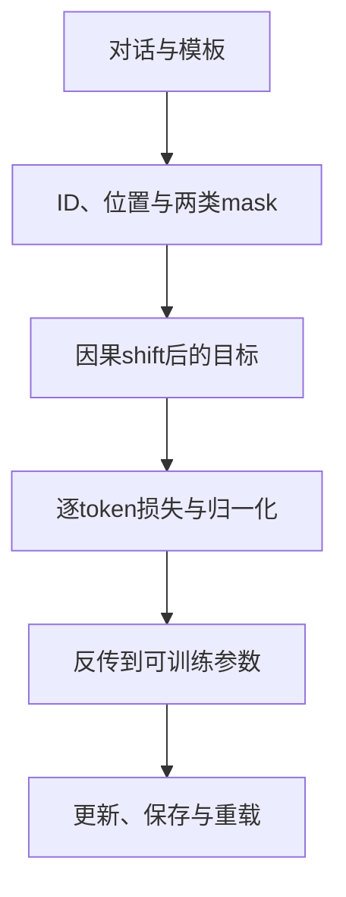

# 监督微调与参数高效适配

::: info 待研究专题
以下是数据、目标与实现的研究路径。真实SFT、adapter重载与效果对照尚未执行，不预设改善。
:::

## 问题与前置依赖

一条对话经过模板后，哪些token参与训练？LoRA实际更新哪些参数？QLoRA量化了什么？loss下降能否转成任务收益？

前置是[数据与预训练](/training/data-pretraining)、tokenizer、因果预测、交叉熵、梯度和小模型生成。资源不够时先做mask和低秩线性层验证，不先追求大模型。

## 核心机制

SFT使用示例目标。对prompt `x`、回答`y`及目标mask `m`，一个completion-only形式为：

$$
\mathcal L_{\rm SFT}=-\frac{1}{\sum_t m_t}\sum_t m_t\log\pi_\theta(y_t\mid x,y_{<t}).
$$

prompt不计入该目标的直接损失，但仍影响回答的条件概率。全序列、completion-only与assistant-only各自有用途，必须按任务和模板明确选择；不能只看数据有`role`字段就认定已经正确屏蔽。[TRL SFT文档](https://huggingface.co/docs/trl/en/sft_trainer)区分这些模式。

LoRA在冻结基矩阵上学习低秩更新：

$$
W'=W+\frac{\alpha}{r}BA,\qquad A\in\mathbb R^{r\times d_{\rm in}},\quad B\in\mathbb R^{d_{\rm out}\times r}.
$$

这里展示常见缩放形式；实现变体另核对。每个目标矩阵新增参数约`r(d_in+d_out)`，仍需激活、梯度和优化器内存。[LoRA原论文](https://arxiv.org/abs/2106.09685v2)是机制来源，不据论文结果承诺当前任务质量。

QLoRA将冻结基座以低比特表示，并训练LoRA适配器；NF4、double quantization和paged optimizer是原方案的重要部分。计算dtype与可训练参数通常仍使用浮点，不能写成“所有参数和反向传播都是4-bit”。[QLoRA论文](https://arxiv.org/abs/2305.14314v1)的硬件实验条件也不能直接套到任意设备。

## 数据与mask格式

合成教学对话：

```json
{"messages":[{"role":"user","content":"将温度12摄氏度转成固定JSON字段。"},{"role":"assistant","content":"{\"temperature_c\":12}"}]}
```

下列ID仅演示prompt/answer/EOS的位置，不对应特定tokenizer：

```json
{"input_ids":[11,12,21,22,2],"attention_mask":[1,1,1,1,1],"labels":[-100,-100,21,22,2]}
```

保存原messages、渲染文本、token IDs、角色边界、labels与有效目标数。核对因果shift由模型还是collator执行，避免偏移两次。`attention_mask`控制可见/有效位置的含义与`labels=-100`忽略损失不同；不能互相替代。

chat template、BOS/EOS、截断和生成时的assistant前缀都要与模型匹配。先模板化后再次分词时检查是否重复添加特殊token。[官方模板文档](https://huggingface.co/docs/transformers/en/chat_templating)说明这些边界。assistant-only模式还依赖所选模板能提供相应mask，不能把一个配置布尔值当作验证。

## 先对齐位置，再计算损失

因果模型在位置`j`输出的是下一个token的分布。前面的五个输入ID中，`11,12`是prompt，`21,22`是回答，`2`是EOS。采用常见的“labels与input_ids先保持同长、loss内部再shift一次”约定，可逐项展开：

| logit所在位置j | 当前位置输入 | 应预测的下一位置标签 | 计入损失？ |
| --- | --- | --- | --- |
| 0 | 11，prompt | -100，原labels[1] | 否 |
| 1 | 12，prompt末尾 | 21，回答首token | 是 |
| 2 | 21 | 22 | 是 |
| 3 | 22 | 2，EOS | 是 |
| 4 | 2，EOS | 本序列没有下一位置 | 否 |

因此，**首个回答token由prompt末尾位置的logits预测**，不是由首个回答token自己的logits预测。在显式参考实现里，配对为`logits[:, :-1]`与`labels[:, 1:]`；若所用模型已经完成这个操作，collator不能再shift一次。逐位置表比“loss能下降”更能发现偏移错误。

令三个计分位置对正确token的预测概率依次为`0.5, 0.25, 0.5`，则解析预期为：

$$
\mathcal L=\frac{-\log 0.5-\log 0.25-\log 0.5}{3}
=\frac{\log 16}{3}\approx0.924196.
$$

分母是三个有效目标，而不是五个输入位置。增加右侧padding、补上被忽略的prompt标签，都不应改变这组已固定logits的损失。改变真实模型的prompt则可能改变logits，所以不能据此要求真实模型输出保持不变。

### 一个能检查梯度的CPU参考

以下只构造“shift之后的四行logits”，回答小词表为`A、B、EOS`，不运行真实语言模型。第一行对应被忽略的prompt目标，后三行对应上表的三个计分位置。

```python
import torch
import torch.nn.functional as F

p = torch.tensor([
    [.20, .30, .50],  # ignored prompt target
    [.50, .25, .25],  # target A
    [.50, .25, .25],  # target B
    [.25, .25, .50],  # target EOS
], dtype=torch.float64)
z = p.log().requires_grad_()
target = torch.tensor([-100, 0, 1, 2])
per_token = F.cross_entropy(z, target, ignore_index=-100, reduction="none")
loss = per_token.sum() / target.ne(-100).sum()
loss.backward()
print(per_token, loss, z.grad)
```

对计分位置，softmax交叉熵给出：

$$
\frac{\partial\mathcal L}{\partial z_{j,k}}
=\frac{p_{j,k}-\mathbf1[k=y_j]}{3}.
$$

因此预期梯度依次为`[0,0,0]`、`[-1/6,1/12,1/12]`、`[1/6,-1/4,1/12]`、`[1/12,1/12,-1/6]`。可以用中心有限差分核对选定的一个logit，并用故意漏shift、错误分母和错mask分别制造失败；比较误差容限而不是只打印一个loss。

这里零梯度指被忽略位置的**独立logits**没有直接损失梯度。真实Transformer中，prompt仍通过Attention影响回答，prompt相关的embedding和共享参数也可能获得梯度；`labels=-100`没有切断这条条件依赖。`attention_mask`也不能拿来替代损失mask。

<figure class="research-figure">



<figcaption>从样本走到参数更新，每一步都要能对应一份可打印、可核对的中间量；损失mask和Attention可见性分别检查。</figcaption>
</figure>

### 多轮、EOS与packing的否证条件

assistant-only应逐轮识别assistant区间，而不是只按最后一个字符串分隔符找答案。先明确是否计入assistant边界标记、终止符和工具消息，再固定策略。若pad与EOS共用ID，应按真实padding位置忽略，而不是将所有相同ID一并改成`-100`；否则模型失去学习结束回答的目标。

packing也有两种不同语义：允许相邻样本连续建模，或要求样本之间独立。后者需要相应的Attention隔离、位置策略和边界label处理；放一个EOS或只把下一段prompt的labels忽略，都不会自动阻止跨样本Attention。验收时把前一条样本替换成无关文本：如果声称两个样本独立，后一条样本的有效位置输出应在声明的数值容限内不变。

## LoRA的一次更新为什么可能只动一侧

令`c=α/r`，上游对`W'`的梯度为`G`。矩阵链式法则给出：

$$
\nabla_B\mathcal L=cGA^\top,\qquad
\nabla_A\mathcal L=cB^\top G.
$$

常见初始化使`A`非零、`B=0`，因此初始`BA=0`、模型前向与基座一致；首步`A`的梯度为零，`B`通常可更新。这不是故障。若两者都初始化为零，则两边梯度都为零，低秩支路无法由普通梯度更新启动；实际初始化选项须对应PEFT快照逐一核对。

梯度为零与参数保持不变也要分开：已有动量、权重衰减或其他优化器处理仍可能改变参数。本页的具体首步算例采用无动量、无权重衰减的SGD，避免把优化器效应混入链式法则检查。

[LoRA论文第4.1节](https://arxiv.org/html/2106.09685v2#S4.SS1)给出低秩参数化与零更新初始化。这里推导的是普通线性层、关闭dropout且不额外训练bias的支路；embedding适配、其他初始化和变体需分别检查。

一个二维算例可排除“只要参数标记可训练就一定在学习”的误判：取冻结 $W=0$、$r=c=1$、$A=[1,-1]$、$B=[0,0]^\top$、输入 $x=[2,1]^\top$、目标 $y=[1,-1]^\top$，损失为 $\tfrac12\|W'x-y\|^2$。此时 $Ax=1$，所以首步 $\nabla_B\mathcal L=[-1,1]^\top$、$\nabla_A\mathcal L=0$；以学习率 $0.1$ 执行无动量SGD后，$B=[0.1,-0.1]^\top$，同一输入上的适配输出应为 $[0.1,-0.1]^\top$。这只是解析检查，不是已完成的微调成绩。

对LoRA分别检验四件事：基座数值不变；预期目标层确实接入适配器；梯度与上述初始化机制相容；保存adapter后，在同一基座revision、相同精度和评估模式下重载能恢复输出。关闭dropout后再比较；保存后直接比较同一内存对象不能证明重载正确。

QLoRA还需多一条路径：低比特基座存储→按后端方式参与浮点计算→叠加可训练低秩支路→反传到适配器。基座冻结并不意味着可以取消整个基座前向的Autograd记录，否则可能连带切断适配器或更早激活所需的梯度。先用一批数据检查实际`requires_grad`、梯度和dtype，再谈节省；量化误差、支持后端与真实峰值内存不能从LoRA的参数公式推得。

## 从参考计算对应到训练器

- [TRL collator与SFTTrainer固定快照](https://github.com/huggingface/trl/blob/f27a906d39cc60aeea576e616f9c829dc4a6ce44/trl/trainer/sft_trainer.py#L89)：沿原始样本→模板→截断/packing→labels→loss检查。
- [PEFT LoRA层固定快照](https://github.com/huggingface/peft/blob/28719900254e5bba0099a834bdca5c8c085f1527/src/peft/tuners/lora/layer.py#L112)：区分基座权重、适配参数、缩放和保存/加载；实际target modules随模型变化。

在这份TRL快照中，进一步将中间量逐项对应：

| 本页检查对象 | 固定源码位置 | 需要解释的连接 |
| --- | --- | --- |
| batch的labels与padding | [collator torch_call](https://github.com/huggingface/trl/blob/f27a906d39cc60aeea576e616f9c829dc4a6ce44/trl/trainer/sft_trainer.py#L173) | labels来源、padding的-100，以及packed序列首位置的处理 |
| 有效token目标 | [compute_loss的NLL分支](https://github.com/huggingface/trl/blob/f27a906d39cc60aeea576e616f9c829dc4a6ce44/trl/trainer/sft_trainer.py#L1673) | 模型返回的log_probs、label_mask与实际归一化分母 |
| 跨设备权重 | [token平均的DDP补偿](https://github.com/huggingface/trl/blob/f27a906d39cc60aeea576e616f9c829dc4a6ce44/trl/trainer/sft_trainer.py#L1683) | 全局token分母与DDP梯度平均如何配合 |

表格是核对入口，不是完整调用链。该分支调用模型的fused LM head；仍需沿实际模型确认shift和忽略位置的实现。本文CPU例子采用普通NLL、没有MoE辅助loss或DFT；若训练器添加了其他目标，先分离各项再比较，不能强求总loss等于示意CE。

运行时锁定TRL/Transformers/PEFT、量化后端、模型与tokenizer revision。选定框架支持的稳定组合，先检查一批样本与可训练参数，不直接复制文档的大训练配方。

## 分级实验

| 层级 | 拟执行实验 | 对照 |
| --- | --- | --- |
| CPU目标 | 手算小logits的masked CE，改变padding与prompt标签，打印每token贡献 | 正确mask与故意错误mask；说明prompt虽不直接计分仍参与条件 |
| CPU低秩层 | 小线性层接入BA，做一次更新并保存/重载 | 检查W冻结、适配器梯度与重载输出；这是机制验证，不是完整LLM微调 |
| 可选GPU | 一个小模型、一份有切分的数据和有界step，先LoRA SFT | 与同基座合理提示基线比较；只改变一种数据或rank因素 |
| 资源受限分支 | 后端支持时再选择QLoRA，与匹配精度方案比较 | 检查量化配置、内存和质量；不要求同时做全参数、LoRA和QLoRA全部实验 |

## 指标与验收产物

交付数据/模板清单、逐token mask、trainable parameters、训练配置与日志、adapter及重载说明。评估保留集任务正确性、格式、长度、退化和运行用量，区分训练loss与生成质量；调参使用开发集，最终测试协议冻结。

保存基座revision、适配器配置、tokenizer与模板；如果合并权重，另记录合并与量化顺序。完成脚本运行、理解机制和证明改进分别验收。

这项方法的深入验收至少包含：能从真实batch重建上面的shift表；用逐token损失复算训练器的目标并说明聚合口径；排查一个mask或EOS错误；从源码定位模板、标签、loss和适配器梯度经过的位置。CPU参考只能闭合它所声明的数学与实现问题，不能代替真实小模型SFT、适配器重载和独立生成对照。

## 常见陷阱

模板不匹配、重复特殊token、答案被截掉、全部labels变成忽略值；pad与EOS相同后误删所有EOS目标；packing使不该互看的样本共享上下文；只统计adapter大小却漏基座/激活；加载adapter时换了基座或target modules。量化降低存储不保证在每种硬件上更快。

## 第一方资料

核验日期：2026-11-16。

本轮机制、TRL损失分支与LoRA初始化复核：2026-11-17。解析数值是待执行参考的预期，不计作个人实验结果。

- [TRL SFT Trainer](https://huggingface.co/docs/trl/en/sft_trainer)：数据格式、mask与PEFT集成。
- [Transformers chat templates](https://huggingface.co/docs/transformers/en/chat_templating)：模板和特殊token。
- [LoRA v2](https://arxiv.org/abs/2106.09685v2)、[QLoRA v1](https://arxiv.org/abs/2305.14314v1)：原始方法与实验条件。
- [PEFT LoRA文档](https://huggingface.co/docs/peft/v0.21.0/package_reference/lora)：配置、参数与适配器参考。

关联：[训练地图](/training/) · [SFT项目](/projects/finetuning-lab) · [偏好优化](/training/preference-optimization)。
